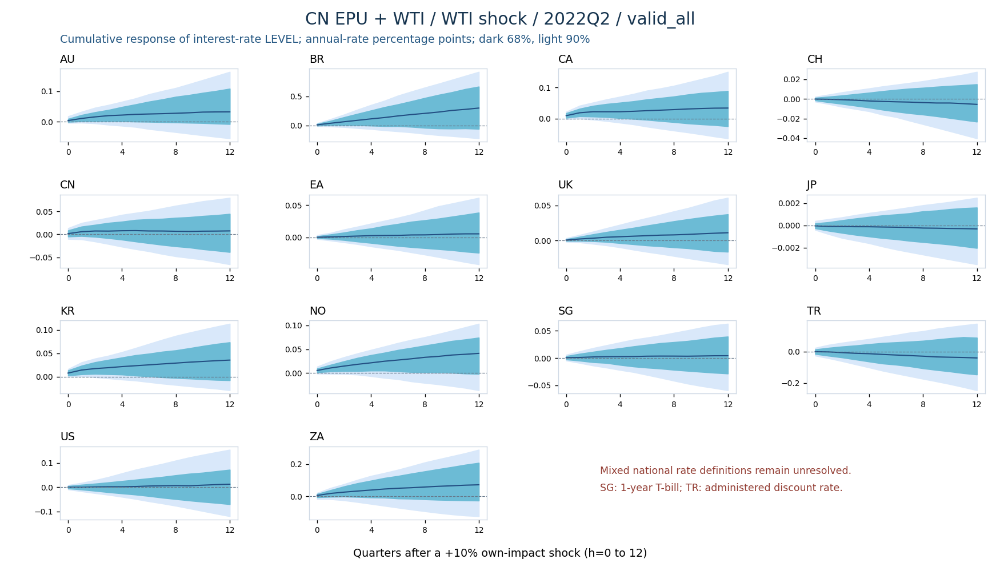
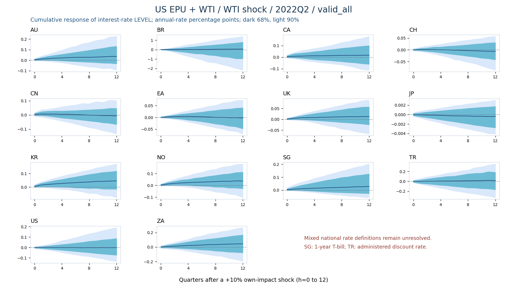

# 利率处理与诊断（2026-10-22）

**决定：暂时保留 Δr；不把“为凑齐样本更换的代理变量”称为统一利率。新增利率水平的累积响应图，并保持原 14 国、2000Q2–2025Q3 的样本不变。此次未重跑 MCMC，也没有替换原始利率观测。**

## 1. 查清了什么

相同的 102 季度样本、含常数的 ADF（AIC 在最多4阶中选择）与 KPSS（自动带宽）：

| 形式 | ADF 在5%拒绝单位根 | KPSS 在5%拒绝平稳 |
|---|---:|---:|
| 利率水平 r | 7/14 | 9/14 |
| 利率差分 Δr | 14/14 | 1/14 |

差分后的 KPSS 警讯来自土耳其。不能因为部分水平序列通过检验，就对全体强制改回水平。结果支持保留差分作为本轮基准，不能证明所有序列平稳或排除结构变化。

另外保存最大8阶 ADF 和含趋势的检验，完整结果见 `results/rate_level_difference_tests.csv`。KPSS 的0.01/0.10是表格边界，文件明确标记，不能当作精确p值。该诊断与旧R脚本的滞后选择不同，不能把两套p值直接混合比较。

## 2. 14国的利率口径

| 经济体 | 当前口径 | 期限 / 统计方式 | 处理判断 |
|---|---|---|---|
| AU、CA、CH、EA、UK、KR、NO、ZA | OECD 三个月货币市场基准 | 月度发布值，三个月齐全才算季度均值 | 保留；OECD分类相同不等于各国信用风险完全一致 |
| BR、JP | OECD 隔夜拆借 / 同业利率 | 隔夜 | 保留并标明期限差异 |
| CN | Atlanta Fed/Higgins–Zha 1天回购 | 发布者季度序列，原比例乘100 | 非三个月利率，仍是定义差异 |
| US | OECD 隔夜拆借 / 同业利率 | 隔夜 | 不将它误标为三个月利率 |
| SG | MAS/SingStat 1年国库券收益率 | 三个月末观测的均值 | 与SORA/SIBOR不同，正式口径未解决 |
| TR | IMF 贴现率 | 管理利率，不是市场成交利率 | 优先待解决，不能称为隔夜利率 |

`results/rate_definition_registry.csv` 给出每国来源、单位、期限与问题标记。四个原代理变更仍是未解决事项，不以显著性或完整性代替经济定义审核。14国口径完全统一的状态明确为 **false**。

## 3. 没有做的错误修补

独立核对 FRED 发布的 OECD 原系列，确认：CN三个月利率2006-01、US三个月利率2020-04、TR隔夜利率2023年九个月确实缺失，不是本地解析误删。见 `results/confirmed_missing_months.csv`。

土耳其央行公布的隔夜借入利率生效日表从2002年开始。把它简单变成月末值，与OECD已有观测在55个月不一致，所以**拒绝用月末政策利率直接填补月度系列**。这不是可以静默修正的同定义补齐。对法律上有效的政策利率作生效日展开，仅用于这个独立对比，不用于补市场数据。

新加坡SIBOR在2024年末停止，SORA不能覆盖1999年。1年券、SIBOR与SORA之间不自动拼接。坚持当前样本起点与全部14国时，不能声称已取得同一种、无缺口的短端利率。

## 4. 利率响应现在如何读

- `raw`：Δr 的响应，单位是年化利率的百分点。
- `rate_level_cumulative`：r 水平的响应，在**每个原始后验抽样内**先对 Δr 响应累加，再取5%、16%、50%、84%、95%分位数。
- 不累加边际区间上下限，也不把累计响应当作又一次模型估计。
- 全部有效抽样 `valid_all` 与稳定条件抽样 `stable_only` 分别保存，不能用后者掩盖不稳定性。
- r水平响应图只修正经济解释与展示，不解决利率定义差异，也不改善MCMC收敛。

完整PDF由审计工作流生成：19个自身峰值日期 × 两种后验筛选 × 两种响应定义 = **76页**，均有68%和90%区间。`plots/rate_response_significance.csv` 逐日期、逐定义、逐筛选统计正/负/含零单元数和显著国家数。单元数每组182，国家数每组14，两者分开。

下面是2022Q2 WTI冲击对利率水平的响应（全部有效后验）：





## 5. 来源与复现

原始估计：[Actions 39647769567](https://github.com/243e106e-coder/tvp-gvar-replication-private/actions/runs/39647769567)，提交 `ac8fcda87a3c34bd557ae401590cff7f622109a7`。原始逐抽样累积代码位于 `8.12/country_epu_oil/run.R`。保存的摘要只提取该次运行中14个 `_r` 变量的两类响应，没有重新估计或改变区间。

独立来源：
- [OECD短期利率定义](https://www.oecd.org/en/data/indicators/short-term-interest-rates.html)
- [FRED中国原序列](https://fred.stlouisfed.org/data/IR3TIB01CNM156N)
- [FRED美国原序列](https://fred.stlouisfed.org/data/IR3TIB01USM156N)
- [FRED土耳其原序列](https://fred.stlouisfed.org/data/IRSTCI01TRM156N)
- [TCMB隔夜利率生效日表](https://www.tcmb.gov.tr/wps/wcm/connect/EN/TCMB%2BEN/Main%2BMenu/Core%2BFunctions/Monetary%2BPolicy/Central%2BBank%2BInterest%2BRates/CBRT%2BINTEREST%2BRATES)
- [MAS基准过渡说明](https://www.mas.gov.sg/regulation/interest-rate-benchmarks-transition)

原响应汇总与来源数值快照均保留。`sources/extraction_receipts.json` 区分原下载内容的SHA256与提取数值表的SHA256。

```bash
pip install numpy pandas scipy statsmodels matplotlib
python3 8.12/rate_audit_20261022/test_rates.py
python3 8.12/rate_audit_20261022/audit_rates.py
python3 8.12/rate_audit_20261022/plot_rate_irfs.py
```

本目录的工作流独立于估计工作流，不触发原模型MCMC。未解决事项不能被检验通过或工作流绿灯替代。
